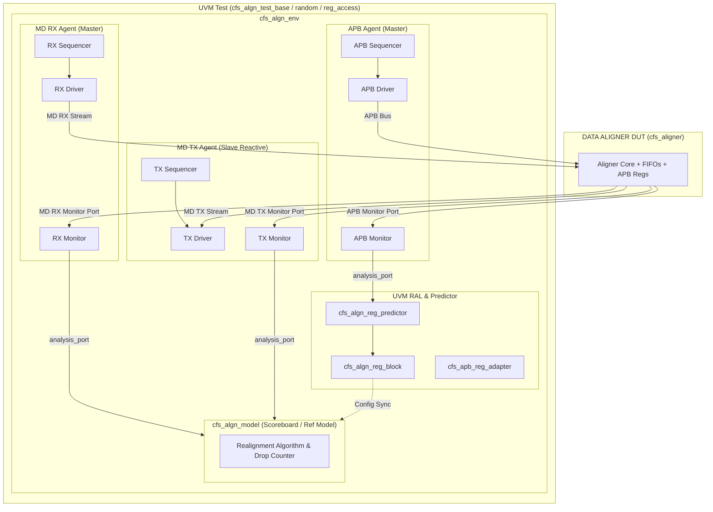

# Data Aligner IP — UVM Verification Environment

[](https://github.com/krishna1226/DATA_ALIGNER_IP-Verification)
[](https://www.accellera.org)
[](#)
[](#)

> [!WARNING]
> **Active Verification Development (WIP)**  
> This repository is a dedicated **SystemVerilog / UVM functional verification project** developed to verify a parameterizable Data Aligner IP (Design Under Test). Core agent infrastructure, register layer integration, reference scoreboard, and initial test sequences are implemented. Work is ongoing for full functional coverage closure, stress corner-case testing, and automated CI regressions.

---

## Table of Contents

- [Overview](#overview)
- [Design Under Test (DUT) Overview](#design-under-test-dut-overview)
  - [Interfaces](#interfaces)
  - [Register Map](#register-map)
- [UVM Verification Architecture](#uvm-verification-architecture)
  - [Environment Diagram](#environment-diagram)
  - [Verification Components](#verification-components)
- [Test Suite & Strategy](#test-suite--strategy)
- [Simulation & Regression Guide](#simulation--regression-guide)
- [Repository Structure](#repository-structure)
- [Verification Roadmap (WIP Tracking)](#verification-roadmap-wip-tracking)
- [Author & Acknowledgments](#author--acknowledgments)

---

## Overview

This project hosts an enterprise-grade **IEEE 1800 UVM 1.1d** compliant verification environment built from the ground up to verify a **Data Aligner IP**. The environment tests dynamic packet realignment, backpressure handling, register programming over APB, error flags, and FIFO watermarks under constrained-random stimulus.

The RTL located in `RTL/` serves strictly as the target **DUT (Design Under Test)** against which the UVM environment and scoreboard execute.

---

## Design Under Test (DUT) Overview

The Data Aligner DUT (`cfs_aligner`) accepts unaligned multi-byte stream packets, buffers them in internal FIFOs, realigns the data according to programmed or packet-driven offsets and sizes, and outputs aligned stream packets.

### Interfaces

| Interface | Type | Signal Group | Description |
|---|---|---|---|
| **Clock & Reset** | System | `clk`, `reset_n` | Global clock and active-low asynchronous reset |
| **APB Slave** | Control / Regs | `paddr`, `pwrite`, `psel`, `penable`, `pwdata`, `pready`, `prdata`, `pslverr` | 32-bit APB bus interface for configuration & status |
| **MD RX** | Packet Input | `md_rx_valid`, `md_rx_data`, `md_rx_offset`, `md_rx_size`, `md_rx_ready`, `md_rx_err` | Streaming packet receiver port with ready/valid handshaking |
| **MD TX** | Packet Output | `md_tx_valid`, `md_tx_data`, `md_tx_offset`, `md_tx_size`, `md_tx_ready`, `md_tx_err` | Streaming packet transmitter port with ready/valid handshaking |
| **IRQ** | Interrupt | `irq` | Level interrupt output signaled on FIFO/drop watermark events |

### Register Map

Registers are 32-bit accessible via the APB bus interface:

| Register | Offset | Access | Fields | Description |
|---|---|---|---|---|
| **CTRL** | `0x0000` | R/W | `[4:0] SIZE`<br>`[9:8] OFFSET`<br>`[16] CLR` | Realignment configuration and soft clear control |
| **STATUS** | `0x000C` | RO | `[7:0] CNT_DROP`<br>`[11:8] RX_LVL`<br>`[19:16] TX_LVL` | Dropped packet count and current FIFO fill levels |
| **IRQEN** | `0x00F0` | R/W | `[0] RX_FIFO_EMPTY`<br>`[1] RX_FIFO_FULL`<br>`[2] TX_FIFO_EMPTY`<br>`[3] TX_FIFO_FULL`<br>`[4] MAX_DROP` | Interrupt enable mask |
| **IRQ** | `0x00F4` | R/W1C | Same as `IRQEN` bits | Interrupt pending status |

---

## UVM Verification Architecture

The testbench is structured following UVM best practices, ensuring modularity, reusability, and clean separation between stimulus generation, protocol driving, passive monitoring, and scoreboard checking.

### Environment Diagram



### Verification Components

1. **`cfs_apb_agent`**:
   - Master APB agent responsible for driving register programming sequences, read verification, and illegal access testing.
2. **`cfs_md_agent` (RX Master)**:
   - Streaming master agent generating variable-sized packets, random offset shifts, and stimulus bursts.
3. **`cfs_md_agent` (TX Slave)**:
   - Reactive slave agent responding to DUT output packets, dynamically inserting backpressure (`md_tx_ready` deassertion) to stress internal FIFOs.
4. **Register Model (`cfs_algn_reg_block`) & Predictor (`cfs_algn_reg_predictor`)**:
   - UVM RAL mirror synchronized passively via the APB monitor and adapter.
5. **Reference Model / Scoreboard (`cfs_algn_model`)**:
   - Reconstructs expected data streams based on current `CTRL` register offset/size configurations.
   - Performs cycle-accurate or packet-level payload matching and flags data corruption or drop counter mismatches.
6. **Reset Handler (`uvm_ext_reset_handler`)**:
   - Graceful in-flight reset handling and component re-initialization.

---

## Test Suite & Strategy

| Test Name | Description | Verification Target |
|---|---|---|
| **`cfs_algn_test_base`** | Instantiates environment, applies reset, verifies initial clocking and baseline idle behavior. | Reset release, hierarchy integrity, phase progression. |
| **`cfs_algn_test_reg_access`** | Comprehensive UVM RAL register read/write sequences, reset value validation, and illegal register write checks (e.g. read-only `STATUS`, out-of-range `CTRL.SIZE`). | APB register map, default values, `pslverr` assertion. |
| **`cfs_algn_test_random`** | Constrained-random stimulus generating high-throughput packets with varied offsets, sizes, and random TX slave delays. | Data realignment correctness, FIFO fill/drain, drop behavior. |

---

## Simulation & Regression Guide

The environment uses a modular Makefile optimized for **QuestaSim / ModelSim** 3-step compilation (`vlog` $\to$ `vopt` $\to$ `vsim`) with UVM 1.1d (`mtiUvm`).

Navigate to the simulation directory:
```bash
cd SIM
```

### 1. Compile RTL & Testbench
```bash
make comp
```

### 2. Run a Single Test
Run the constrained-random test:
```bash
make sim TEST=cfs_algn_test_random SEED=100
```
Run register access test:
```bash
make sim TEST=cfs_algn_test_reg_access
```
Override verbosity or timeout:
```bash
make sim TEST=cfs_algn_test_random +UVM_VERBOSITY=UVM_HIGH +UVM_TIMEOUT=5000000
```

### 3. Run Full Regression Suite
Executes all regression tests sequentially (`cfs_algn_test_base`, `cfs_algn_test_reg_access`, `cfs_algn_test_random`):
```bash
make regress
```

### 4. Interactive Debug with Waveforms
Launches QuestaSim GUI with predefined wave signals (`wave.do`):
```bash
make wave TEST=cfs_algn_test_random
```

### 5. Clean Workspace
Purges simulator work libraries, compilation binaries, and log files:
```bash
make clean
```

---

## Repository Structure

```
DATA_ALIGNER_IP/
├── .gitignore                      # Simulator and temporary file exclusion rules
├── README.md                       # Verification environment documentation (this file)
│
├── ENV/                            # UVM Environment & Verification Components
│   ├── APB_AGENT/                  # APB master UVM agent (driver, monitor, sequencer, types)
│   ├── CFS_MD_AGENT/               # Packet streaming agent (master RX & slave TX, coverage)
│   ├── REG_FILES/                  # UVM RAL register definitions (CTRL, STATUS, IRQ, IRQEN)
│   ├── UVM_EXT_AGENT/              # Agent extensions, base classes, reset handlers
│   ├── cfs_algn_env.sv             # Top-level UVM environment
│   ├── cfs_algn_env_config.sv      # Environment configuration object
│   ├── cfs_algn_model.sv           # Reference model / Scoreboard
│   ├── cfs_algn_reg_predictor.sv   # APB-to-RAL predictor
│   ├── cfs_apb_reg_adapter.sv      # UVM reg adapter for APB bus
│   ├── cfs_apb_if.sv               # SystemVerilog interface for APB bus
│   ├── cfs_md_if.sv                # SystemVerilog interface for MD streaming bus
│   └── cfs_algn_pkg.sv             # Environment package declaration
│
├── TEST/                           # UVM Testcases & Sequences
│   ├── cfs_algn_test_base.sv       # Base test class
│   ├── cfs_algn_test_reg_access.sv # Register model access & error tests
│   ├── cfs_algn_test_random.sv     # Random constrained traffic test
│   └── cfs_algn_test_pkg.sv        # Test package declaration
│
├── TOP/                            # Top-level Testbench Module
│   └── testbench.sv                # Clock/reset generators, DUT instance, interface binds
│
├── RTL/                            # Design Under Test (DUT) Sources
│   ├── cfs_aligner.v               # Top-level DUT wrapper
│   ├── cfs_aligner_core.v          # Aligner core pipeline logic
│   ├── cfs_ctrl.v                  # Main control logic
│   ├── cfs_regs.v                  # APB register file implementation
│   ├── cfs_rx_ctrl.v               # RX FIFO & flow controller
│   ├── cfs_tx_ctrl.v               # TX FIFO & flow controller
│   └── ...                         # Synchronizers, FIFOs, edge detectors
│
└── SIM/                            # Simulation & Regression Automation
    ├── makefile                    # QuestaSim / ModelSim 3-step automation makefile
    └── wave.do                     # Pre-configured signal layout for waveform debug
```

---

## Verification Roadmap (WIP Tracking)

- [x] **Phase 1: TB Architecture & Infrastructure**
  - [x] APB Agent & CFS MD RX/TX Agent architecture
  - [x] Top-level testbench binding & clock/reset generation
  - [x] UVM RAL integration & APB adapter
- [x] **Phase 2: Core Sequences & Sanity Verification**
  - [x] Reset sequence & base test (`cfs_algn_test_base`)
  - [x] Register access & legal/illegal write tests (`cfs_algn_test_reg_access`)
  - [x] Constrained-random packet realignment tests (`cfs_algn_test_random`)
- [ ] **Phase 3: Coverage Closure & Advanced Stress (In Progress)**
  - [ ] Comprehensive Functional Coverage Model (cross-coverage of offset $\times$ size $\times$ backpressure)
  - [ ] Back-to-back FIFO overflow / underflow watermark stress scenarios
  - [ ] Asynchronous Clock Domain Crossing (CDC) verification mode
  - [ ] Automated regression reporting script with pass/fail summary & coverage merging

---

## Author & Acknowledgments

- **Verification Environment**: Krishna P.
- **Methodology**: Accellera IEEE 1800 UVM 1.1d
- **Repository**: [krishna1226/DATA_ALIGNER_IP-Verification](https://github.com/krishna1226/DATA_ALIGNER_IP-Verification)
